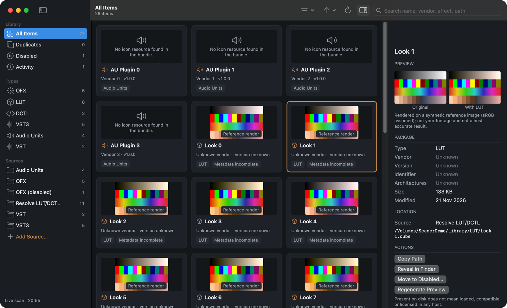

# Scaner GDC

A free macOS app that finds the **OFX, LUT, DCTL, VST3, Audio Unit and VST** resources installed on your Mac, shows what each one is,
previews it, and lets you set items aside and bring them back. Scanning only reads; **Disable** and **Restore** move files, with a recorded way back.


*Synthetic test library — no personal data.*

## What it does
- **Scan** the standard plug-in and LUT folders, the DaVinci Resolve LUT/DCTL folder and any folder you add. Read-only: plug-in binaries are only read up to the Mach-O header, and nothing is ever executed.
- **Inspect** name, vendor, version, identifier, architectures, size and location from the package's own metadata. Unknown stays unknown; items found in several places are flagged as duplicates.
- **Preview** bundle icons and `.cube` LUTs (before/after on a synthetic reference image). DCTL is never run.
- **Organize**: *Move to Disabled…* checks first, asks for confirmation, and moves the item to a sibling folder “… (Disabled by GDC)” (or a folder you choose). *Restore* puts it back. Same volume: one atomic rename that refuses to overwrite. Across volumes: copy, verify, then the original goes to the Trash. Every operation is journaled and interrupted ones are recovered at launch.
- **Product details (optional)**: add a cover, a short description, the producer and the official page for an item — from your own image or from an official page address you associate. Real previews, package icons, online covers and your own images are always labelled separately; a cover is never presented as a render of the effect, and DCTL is never run. Online lookup is **off until you use it**, sends only a product's technical name, producer and identifier (or the address you give), never paths, files or licences, and stores third-party images only on your Mac. Automatic search is an **advanced, experimental, off-by-default option** that needs your own Brave Search API key (a separate service with its own terms and possible costs; the Brave browser does not provide it; the key is kept in your Keychain). The app works fully without it: associate an official page and choose your own image. Search results are shown in memory only and never saved, because Brave's standard plan does not allow storing them; only an address you associate yourself is saved. Without a key items are reported as “not searched”, never “not found”. Not verified against the live authenticated service. See `docs/DISCOVERY.md`.
- **Diagnostics**: an anonymized, local export (paths redacted unless you opt in); nothing is uploaded.

## Limits (real ones)
- “Present on disk” does not mean loaded, compatible or licensed in any host application. Plug-ins are never loaded or validated.
- Locations that need administrator rights (for example `/Library`) are not modified: the operation is blocked with an explanation; there is no privileged helper.
- Running host applications keep loaded plug-ins until they restart; the app warns when a known host is running and never closes anything.
- Vendor and version appear only when the package declares them. Online details never replace the installed version.

## Download and install
Releases: https://github.com/gordasgdc/scaner-gdc/releases · Site: https://gordasgdc.github.io/scaner-gdc/
**Updates:** the app has no self-updater and does not check for updates; to update, download the new release and replace the app. The Corresponding Source of every release is the tagged commit of this repository (including the build scripts).
Open the disk image and drag **Scaner GDC** to Applications. Requires **macOS 14 (Sonoma) or later**; the package is universal (Apple silicon and Intel) and is Developer ID signed and notarized by Apple, with a stapled ticket.
Network use: scanning is local and needs no internet or account; only the optional product-details features use the internet when you ask. No telemetry, no automatic upload of your inventory ([privacy](docs/PRIVACY.md)).

## Reporting problems
Open an issue and use the template (`.github/ISSUE_TEMPLATE`). Please include the app version, macOS version, what you did and what you expected.
**Do not attach your plug-in inventory or home-folder paths.** If a diagnostics export helps, use *File → Export Diagnostics…* (anonymized by default; the Settings pane has an opt-in to include paths) and read it before sharing.

## Build from source
```bash
cp scripts/local.env.example scripts/local.env   # set the output root (a mounted, writable volume)
scripts/preflight.sh                              # tests + release build + checks
scripts/build-app.sh release                      # prints the .app path
scripts/release.sh                                # signed + notarized DMG (needs your own Developer ID and notarytool profile; clean Git tree)
```
Swift 6 / SwiftUI / SwiftPM, macOS 14+, no third-party dependencies. Architecture: `docs/ARCHITECTURE.md`. Release flow: `docs/RELEASE_AND_ROLLBACK.md`.

## Licence
**GNU GPL v3 only, with additional terms under §7** (author attribution, no misrepresentation of origin, no trademark grant): `LICENSE` (official text, unmodified) and `LICENSE-ADDITIONAL-TERMS.md`.
The name "Scaner GDC" and the logo are outside the GPL grant: `branding/BRANDING.md` (unmodified use to identify the original is allowed; modified versions use their own identity; a neutral icon is provided for derived builds). Third-party notices: `THIRD_PARTY_NOTICES.md`.

## Author
**Scaner GDC — creat de Cristi Gordaș (GDC).** Scaner GDC is independent from, and prepared to integrate with, GDC Plugin Manager.
